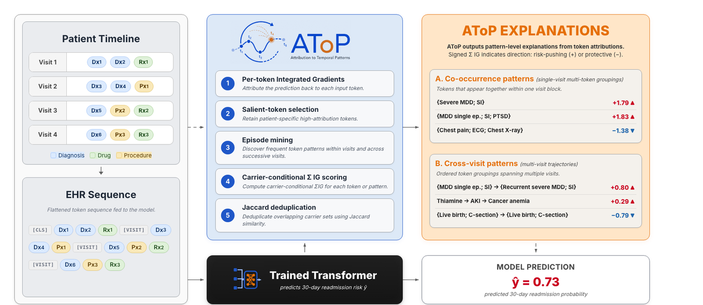
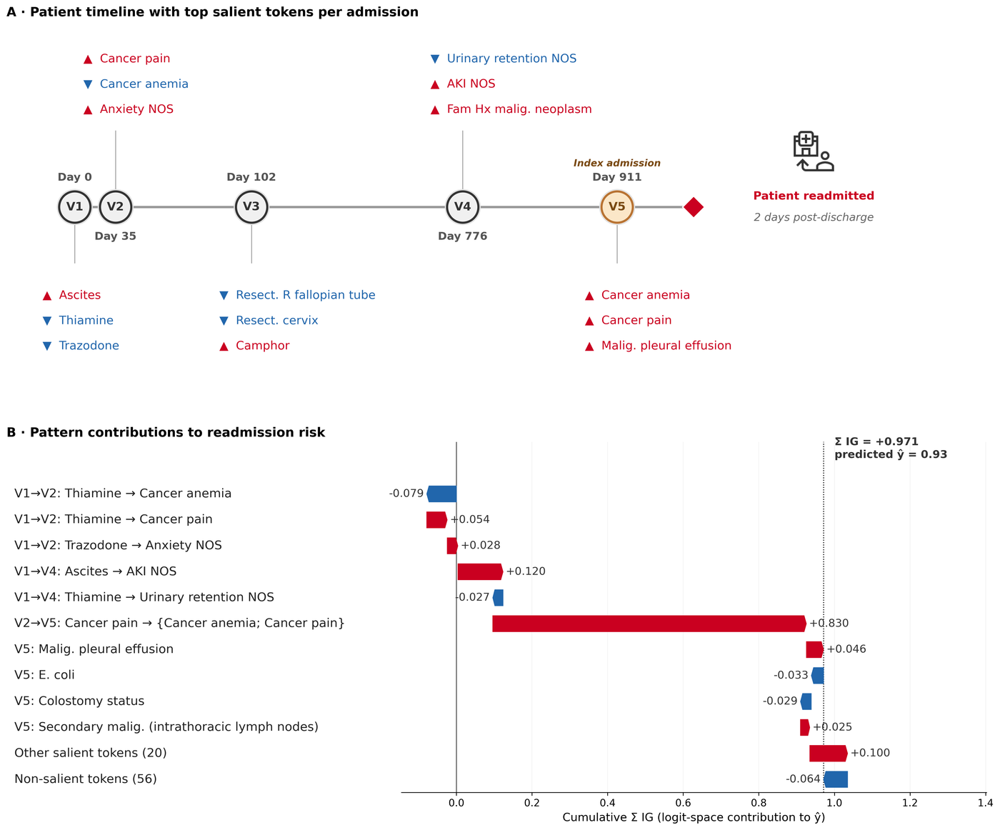
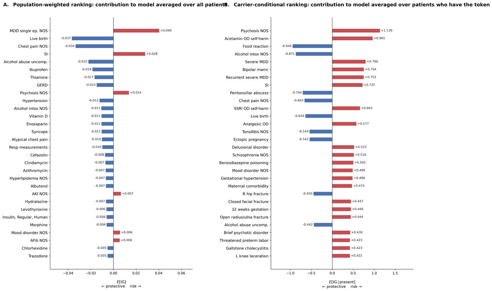
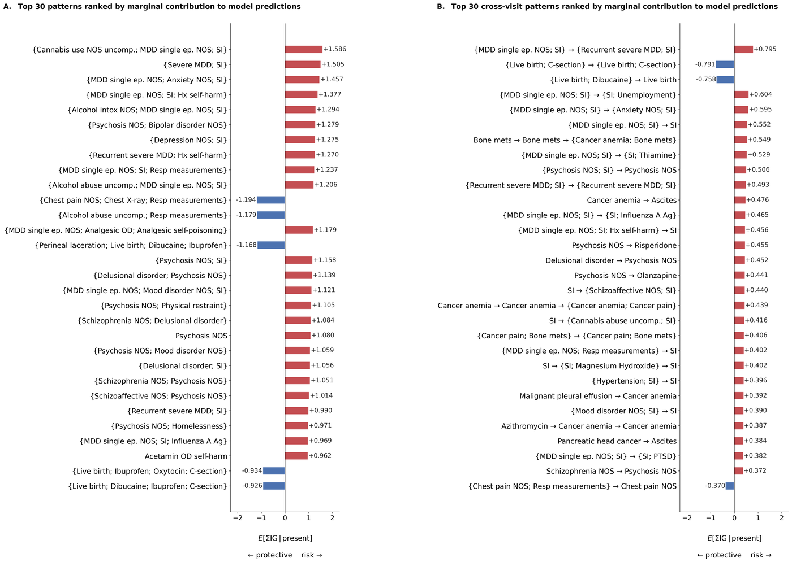

# AToP: Attribution-guided Temporal Pattern Mining for EHR Explainability

AToP is a post-hoc explainability framework for Transformer-based clinical prediction models trained on longitudinal Electronic Health Record (EHR) data. It turns per-token Integrated Gradients attributions into structured **temporal pattern narratives** — not just which tokens matter, but which *sequences of clinical events across encounters* drive a prediction.



## Why AToP?

Standard XAI methods (SHAP, IG, attention) produce flat per-token importance scores. These miss the temporal structure that makes clinical reasoning meaningful: a diagnosis in visit 1 followed by a treatment in visit 3 is a clinically different signal than either event in isolation. AToP mines these cross-visit trajectories and validates them against model behaviour.

Two conventions do the work:

- **Carrier-conditional aggregation.** Standard global importance averages attribution over *all* patients, so a rare feature with large per-patient impact is diluted by its prevalence. AToP reports `E[score | present]` — the attribution among patients who actually carry the token or pattern.
- **Pattern-level ΣIG.** Attribution is summed over the constituent tokens of a data-discovered multi-visit pattern, moving the unit of explanation from an isolated code to a trajectory.

## Framework Overview

AToP operates in five stages on a trained Transformer:

1. **Attribution** — per-token Integrated Gradients; retain the tokens carrying 80% of per-patient attribution mass
2. **Mapping** — map salient tokens back to their admission-block structure
3. **Mining** — frequent-episode mining over training-cohort salient subsequences
4. **Aggregation** — carrier-conditional token-level and pattern-level ΣIG
5. **Deduplication** — Jaccard ≥ 0.2 clustering on carrier sets, keeping the highest-magnitude representative per phenotype

## What the output looks like

**Single-patient explanation.** Panel A is the admission timeline with the salient tokens each visit contributed; Panel B decomposes the predicted risk into the matched temporal patterns, under a deterministic non-overlapping allocation so the bars sum to the total ΣIG.



**Token-level global attribution.** Population-weighted (left) versus carrier-conditional (right). The two rankings share only 7 of 30 tokens: carrier-conditioning surfaces rare, high-impact features that prevalence weighting buries.



**Pattern-level global attribution.** All patterns (left) versus cross-visit only (right). The cross-visit restriction surfaces a structurally distinct family of multi-visit phenotypes rather than a refinement of the all-pattern ranking.



## Installation

```bash
pip install git+https://github.com/belouali/atop.git
```

Or clone and install locally:

```bash
git clone https://github.com/belouali/atop.git
cd atop
pip install -e .
```

## Quick Start

```python
import atop

# Load a trained model bundle (produced by scripts/train_model.py)
explainer = atop.AToPExplainer.from_bundle(
    run_dir="runs/exp01",
    mimic_dir="/data/mimiciv/hosp"
)

# Run the full pipeline
explainer.compute_attributions()
explainer.mine_patterns(method="episode")
explainer.validate(top_k=15)
explainer.report(out_dir="explanations/")
```

## Reproducing Paper Results

The paper's run directory is `runs/mimiciv_readmission_30d`. Every script below takes
`--run_dir`, and the figure and table scripts also take `--split` (default
`test`). Run them from `scripts/`.

**1. Build the cohort and train the model**

```bash
python scripts/preprocess.py --mimic_dir /data/mimiciv/hosp --out_dir runs/mimiciv_readmission_30d
python scripts/train_model.py --run_dir runs/mimiciv_readmission_30d
```

**2. Attribution, mining and validation**

```bash
python scripts/run_atop.py --run_dir runs/mimiciv_readmission_30d --mimic_dir /data/mimiciv/hosp
python scripts/build_validation_whitelist.py --run_dir runs/mimiciv_readmission_30d
python scripts/run_validation_topup.py --run_dir runs/mimiciv_readmission_30d
python scripts/run_reversed_order_topup.py --run_dir runs/mimiciv_readmission_30d
```

**3. Baselines (Table 2)**

```bash
python scripts/reproduce_lace_baselines.py      # LR + XGBoost on LACE covariates
python scripts/table_s1_auroc_bootstrap.py      # paired-bootstrap ΔAUROC CIs
```

Note: these baselines use the four LACE components (length of stay, acuity,
Charlson comorbidity index, ED visits in the prior 6 months) plus age, sex and
prior admissions. They are *not* the published LACE+ index.

**4. Cross-method replication (KernelSHAP)**

```bash
python scripts/build_cohort_shap_cache.py --run_dir runs/mimiciv_readmission_30d
python scripts/build_shap_aggregations.py --run_dir runs/mimiciv_readmission_30d
```

**5. Main figures and tables**

```bash
python scripts/make_fig2.py   --run_dir runs/mimiciv_readmission_30d   # single-patient explanation
python scripts/make_fig3.py   --run_dir runs/mimiciv_readmission_30d   # token-level attribution
python scripts/make_fig4.py   --run_dir runs/mimiciv_readmission_30d   # pattern-level attribution
python scripts/make_fig5.py   --run_dir runs/mimiciv_readmission_30d   # perturbation validation
python scripts/make_table1.py --run_dir runs/mimiciv_readmission_30d   # cohort characteristics
python scripts/make_table2.py --run_dir runs/mimiciv_readmission_30d   # predictive performance
python scripts/make_table3.py --run_dir runs/mimiciv_readmission_30d   # Tables 3 and 4
```

Figure 1 is a hand-drawn schematic, not generated from data.

**6. Supplementary figures**

```bash
python scripts/make_fig_s1.py  --run_dir runs/mimiciv_readmission_30d   # reversal attenuation
python scripts/make_fig_s7_jaccard_sensitivity.py  --run_dir runs/mimiciv_readmission_30d
python scripts/make_fig_s8_full_pool_sensitivity.py --run_dir runs/mimiciv_readmission_30d
python scripts/make_fig_s11_shap_fig3.py --run_dir runs/mimiciv_readmission_30d
python scripts/make_fig_faithfulness.py --run_dir runs/mimiciv_readmission_30d
```

(`make_fig_s2.py` … `make_fig_s12.py` follow the same convention.)

## Repository layout

```
atop/
  attribution/   Integrated Gradients and saliency selection
  mining/        frequent-episode mining over salient subsequences
  explain/       carrier sets, Jaccard deduplication, pattern labels,
                 matching, validation, figure helpers
  models/        single-stream Transformer and training loop
  explainer.py   AToPExplainer, the top-level pipeline
scripts/         end-to-end pipeline, every paper figure and table
docs/images/     figures used in this README
```

## Requirements

- Python ≥ 3.9
- PyTorch ≥ 2.0
- MIMIC-IV v3.1 (credentialed access via PhysioNet)

Install dependencies with `pip install -e .` (see `pyproject.toml`).

## Citation

> Belouali A, Kharrazi H. AToP: An Explainability Framework for Transformer-Based EHR Predictions
> Using Attribution-Guided Temporal Pattern Mining. *(under review)*

## License

MIT License. See `LICENSE` for details.

## Acknowledgments

This work uses [MIMIC-IV](https://physionet.org/content/mimiciv/), a freely accessible critical care database.
Data access requires credentialed PhysioNet registration. No patient-level data is included in this repository.
